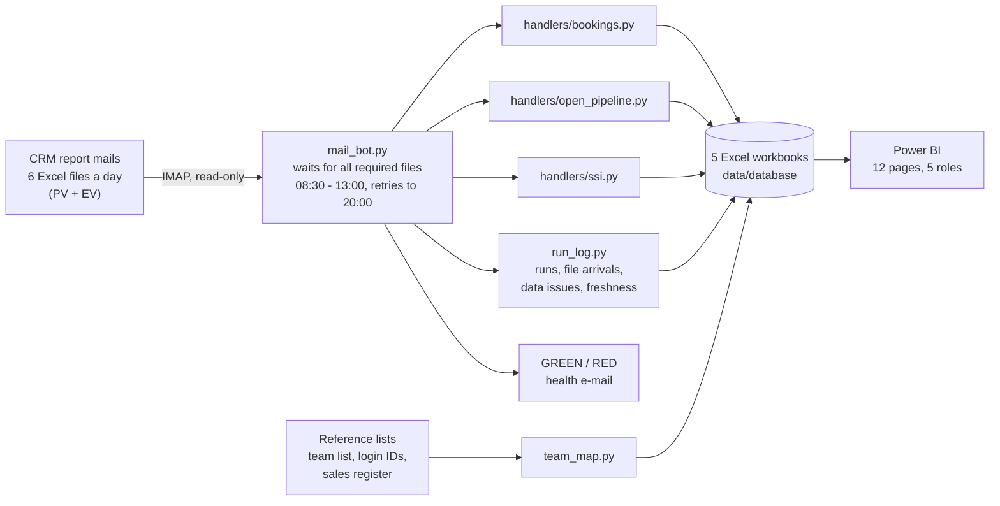
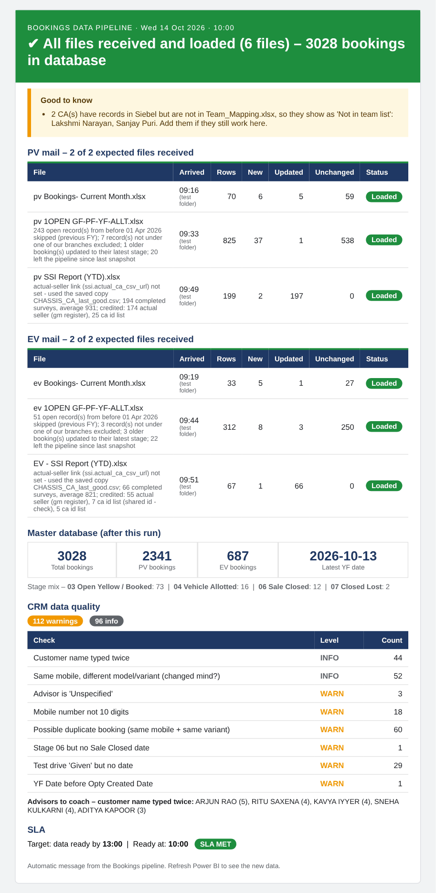
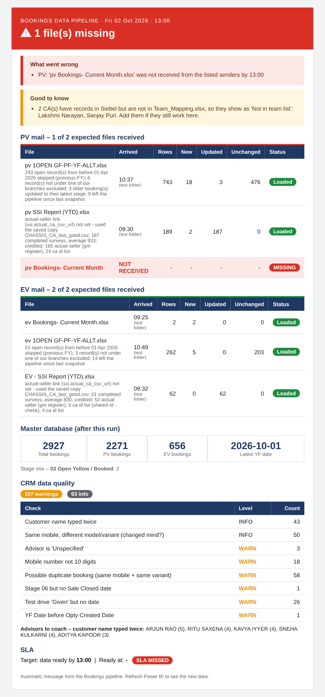
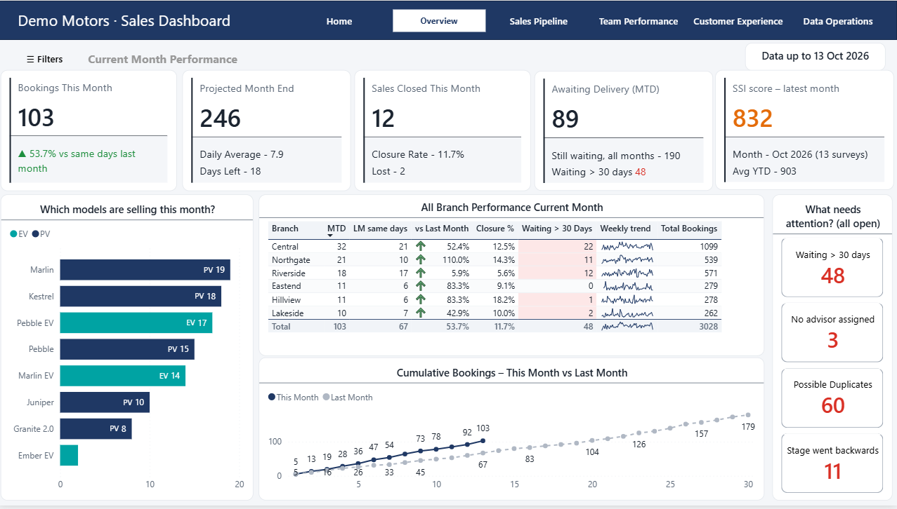
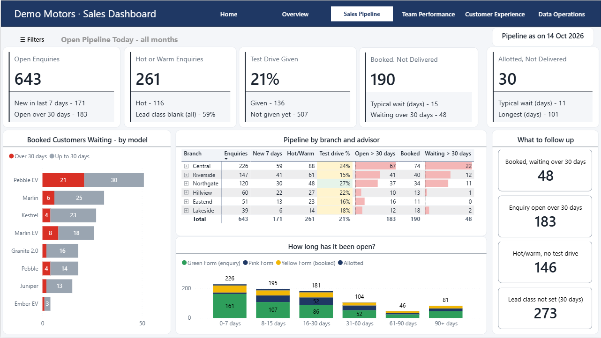
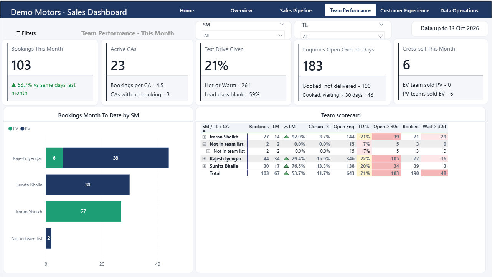
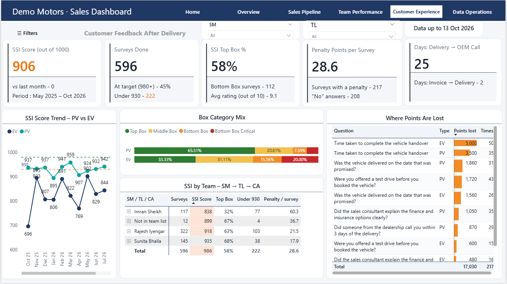
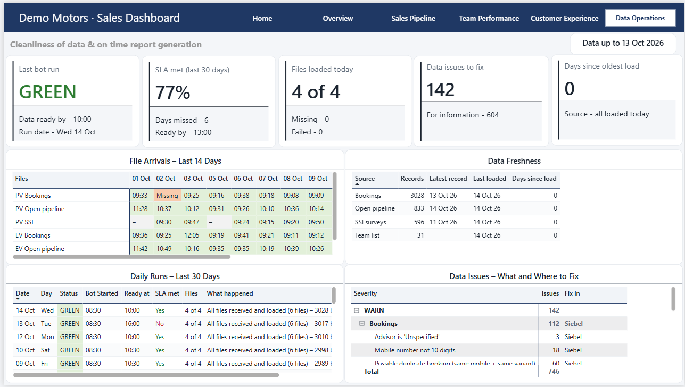
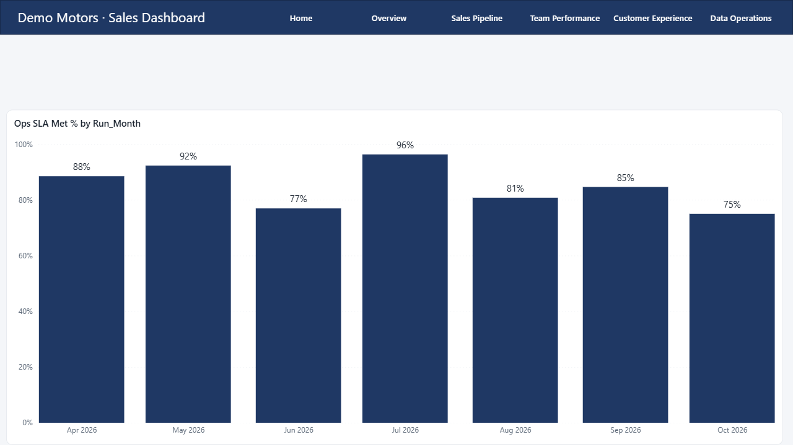

# Dealership Sales Pipeline

**From daily CRM report e-mails to a role-based Power BI dashboard, with no manual Excel work.**

[](https://github.com/RajdeepSinghhora/dealership-sales-pipeline/actions/workflows/ci.yml)

Every morning a car dealership's CRM e-mails six Excel reports covering passenger (PV) and electric (EV) vehicles:

- bookings for the month
- every open enquiry and booking
- the manufacturer's customer-satisfaction (SSI) surveys

Before this project, someone copied these reports into spreadsheets by hand. Now a Python bot does the work:

- reads the mailbox
- cleans and validates every file
- keeps history in five Excel workbooks
- sends a GREEN / RED health e-mail

A 12-page Power BI report then gives each role its own view: directors, sales managers, team leaders, customer experience, and sales operations.

> **All data in this repository is fictional.** It is generated by `demo/` for "Demo Motors", an invented dealer.
> - People, customers and vehicles are made up.
> - Phone numbers start with `1`, so none can be a real Indian mobile number.
> - The production configuration, mailbox and data are not part of this repository.



## Try it in two minutes

You need Python 3.11 or newer.

```bash
git clone https://github.com/RajdeepSinghhora/dealership-sales-pipeline.git
cd dealership-sales-pipeline
pip install -r requirements.txt
python demo/run_demo.py --end-date 2026-10-12
```

The demo generates six months of history for Demo Motors. It then replays twelve report mornings through the real bot, with the clock simulated. Some of those days include problems on purpose:

- the laptop starts late
- a file arrives after the 13:00 cut-off
- a file is never sent
- a file with the wrong layout is re-sent
- a day comes without survey files

The output looks like this:

```
     Fri 02 Oct  10:00 GREEN
     Sat 03 Oct  13:00 RED (cut-off: EV 1OPEN still missing)  ->  14:30 GREEN
     Mon 05 Oct  13:00 RED (cut-off: EV 1OPEN never sent)
     Wed 07 Oct  10:00 RED (EV bookings file has the wrong layout)  ->  12:00 GREEN
4/4  Result
     master_bookings.xlsx   Bookings 747 | Stage_History 807 | Load_Log 34 | DQ_Issues 54
     open_pipeline.xlsx     Open_Now 524 | Open_Trend 1,593 | Pipeline_Exits 180 | Open_Issues 516
     ssi.xlsx               SSI_Surveys 232 | SSI_Answers 2,748 | SSI_Issues 13
     ...
```

For the full data set behind the screenshots, run `python demo/run_demo.py --full`. It takes 20–30 minutes, because every morning goes through the real bot:

- **History from 1 April of the previous financial year**, so you get two financial years and year-over-year comparisons. Last year's surveys come from that year's final SSI file.
- **About 1.5 times the volume:** roughly 10,000 opportunities, 3,000 bookings and 700 surveys.
- **Seasonality and trends:** busy festive months and a March push, EV share growing over time, and this year ahead of last year.
- **31 days of daily runs:** every view of the Data Operations page is full. Normal mornings are mixed at realistic rates with late starts, late, missing or broken files, and days without survey files. Every kind of problem happens at least once, and two days close RED because a required file never arrived.
- **Six months of SLA history:** the report days from 1 April up to the replayed month are written as the `state/<date>.json` files the bot leaves behind each day. `src/run_log.py` rebuilds Daily_Runs and File_Loads from them, which is the same path the real installation used to fill its history. These rows are marked `Recorded = Rebuilt`, and the replayed days are marked `Live`.

With `--full --end-date 2026-10-14` the result is:

```
     master_bookings.xlsx   Bookings 3,028 | Stage_History 3,289 | Load_Log 87 | DQ_Issues 208
     open_pipeline.xlsx     Open_Now 833 | Open_Trend 4,216 | Pipeline_Exits 564 | Open_Issues 740
     ssi.xlsx               SSI_Surveys 602 | SSI_Answers 7,152 | SSI_Issues 22
     team_map.xlsx          Team_Map 36 | Team_History 31 | Map_Issues 7
     run_log.xlsx           Daily_Runs 169 | File_Loads 1,014 | Data_Issues 746 | Data_Freshness 4
     Daily runs: 169 days, 162 GREEN, data ready by 13:00 on 145 of 169 days
```

You can explore the results in three places:

- Open `logs/health_*.html` in a browser to see the e-mails the bot would have sent.
- Open the workbooks in `data/database/`.
- Point Power BI at that folder ([docs/power-bi-guide.md](docs/power-bi-guide.md)).

Run the tests with `pip install -r requirements-dev.txt && pytest`. One of them runs the whole demo end to end.

## The daily health e-mail

| All files loaded | A required file did not arrive by the cut-off |
|---|---|
|  |  |

## The dashboard

| Role | Page | Question it answers |
|---|---|---|
| Directors / CEO | **Overview** | How is this month going against last month, and what needs attention? |
| Sales managers | **Sales Pipeline** → *Follow-up lists* | What is open, what is stuck, and who should be called today? |
| Team leaders | **Team Performance** | How is each sales manager, team leader and sales consultant doing, and where are the cross-sales? |
| Customer experience | **Customer Experience** → *Call-back list* | How do customers rate the delivery, where are points lost, and whom do we call back? |
| Sales operations | **Data Operations** → *Issue details*, *SLA history* | Did today's files arrive on time, how has the SLA held up month by month, and what must be fixed, and where? |

There are 12 pages in total: 6 in the menu and 6 drill-through or detail pages. They use more than 150 DAX measures, organised in measure tables. See [docs/dax-measures.md](docs/dax-measures.md).

The screenshots show the fictional Demo Motors data that `demo/run_demo.py --full` creates.



| Sales Pipeline | Team Performance |
|---|---|
|  |  |
| **Customer Experience** | **Data Operations** |
|  |  |

SLA history: the share of report days with the data ready by 13:00, month by month.



## What is interesting under the hood

- **Idempotent, restart-safe loads.**
  - The bot remembers each processed file in `state/<date>.json`, keyed by name and SHA-1. A rerun only processes what is new.
  - `Opty Id` is the only key, so bookings are upserted, never duplicated.
  - Only one copy of the bot can run at a time. A second copy, for example a manual run while the scheduled one is still going, stops at once without touching anything.
  - Every workbook is written to a temp file of its own, read back completely, and only then swapped in, so a damaged file can never replace a good one. If Excel or a Power BI refresh is holding the file open, the bot retries.
  - Each workbook gets one dated backup per day, kept for 30 days. `check_workbooks.py --restore` puts back the newest good copy and lists the days to load again.
- **Schema drift handled by content, not position.**
  - The CRM export has several columns called `Division`. The right one is found by its value pattern (`3999001-Sales-Central-Demo`).
  - The manufacturer once put two questionnaires side by side in the SSI file, with score and answer columns interleaved. Columns are now paired by question text, and near-identical texts (typos) are merged. If any score column is left without an answer column, a *layout check* note goes into the health e-mail.
- **Who really sold it.** Some CRM logins are shared, so each survey is credited using the first source that knows the seller. The `CA_Source` column records which one was used, so every credit can be audited.
  1. The sales register, by chassis number.
  2. The login-ID list.
  3. The owner of the login in the CRM.
- **Strict name matching.**
  - Team-list names are matched to CRM names word by word, so `KAVYA IYER` = `KAVYA IYYER` and `ARJUN RAO` = `ARJUN KUMAR RAO`.
  - `ROHAN MEHTA` is never merged with `ROHAN VERMA`.
  - One-word names are never matched by spelling.
- **Data quality is a product, not an afterthought.**
  - 18 booking checks and pipeline hygiene checks run on every load, plus checks on surveys and the team list.
  - Every issue is graded WARN or INFO and says *where to fix it*: CRM, team list, ID list, or nothing (waiting for the manufacturer).
- **Operations you can trust.**
  - The bot waits for the network after the laptop wakes up, and keeps Windows awake while it runs.
  - It retries until 20:00 and sends a RED crash e-mail if it hits an unexpected error.
  - It records the first time the data was ready. Reruns never move that time, a day recovered on a later date counts as an SLA miss, and so does a day that ends RED.
- **Testable without a mailbox.**
  - `source_mode: folder` reads the files from a folder instead of a mailbox.
  - `demo/_clock.py` runs the unmodified bot at any simulated date and time.
  - Replaying the demo found a real bug: a day that ended RED at the cut-off was not counted as an SLA miss. It is fixed, and a test covers it.
  - A production incident is reproduced in the tests: two copies started in the same minute and damaged a workbook through a shared temp file. Now the second copy is stopped, and the restore tool is tested end to end.

## Repository layout

```
src/
  mail_bot.py          the bot: mailbox -> handlers -> health mail (entry point, run by Task Scheduler)
  handlers/            one module per report type (bookings, open_pipeline, ssi, _template)
  team_map.py          CA -> TL -> SM mapping from the team list, with history
  run_log.py           Data Operations workbook: daily runs, file grid, data issues, freshness
  run_lock.py          only one copy of the bot at a time
  check_workbooks.py   can every workbook be read? --restore puts back the newest good backup
  health_email.py      the GREEN / RED HTML mail
  backfill.py          loads old months safely (never overwrites newer data)
demo/
  generate_demo_data.py   fictional dealership in the exact CRM layouts
  run_demo.py             backfill + replay of two weeks of mornings with the real bot
  _clock.py               runs the bot at a simulated date and time
config/
  config.example.json  template for production (IMAP)
  config.demo.json     used by the demo (folder mode, no e-mail)
docs/                  architecture, data model, DAX, Power BI guide, setup, case study
tests/                 pytest: unit tests + one end-to-end demo run (CI on Linux and Windows)
run_bot.bat            Windows launcher used by Task Scheduler
```

## Documentation

- [Architecture and the daily run](docs/architecture.md)
- [Data model: workbooks, sheets, Power BI relationships](docs/data-model.md)
- [DAX measures](docs/dax-measures.md)
- [Power BI guide: connect the report to the demo data](docs/power-bi-guide.md)
- [Production setup on Windows](docs/setup.md)
- [Case study: problems found and how they were solved](docs/case-study.md)

## Tech

Python 3 (pandas, openpyxl, imaplib/smtplib), Windows Task Scheduler, Excel workbooks as the storage layer, Power BI Desktop (Power Query, DAX, star schema), pytest, GitHub Actions.

## License

MIT. See [LICENSE](LICENSE).
