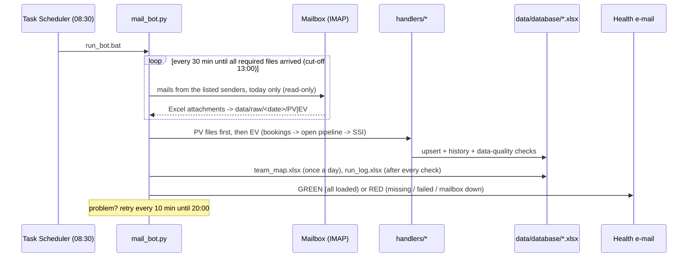

# Architecture and the daily run

## The problem

A multi-branch car dealership sells passenger (PV) and electric (EV) vehicles. Its CRM (Siebel, provided by the manufacturer) can only *e-mail* reports, so every morning six Excel files arrive:

| Group | File | What it is |
|---|---|---|
| PV / EV | `pv Bookings- Current Month` / `ev …` | Every booking (YF date) of the current month, with its stage today |
| PV / EV | `pv 1OPEN GF-PF-YF-ALLT` / `ev …` | Snapshot of everything open: enquiries (Green / Pink Form), bookings (Yellow Form) and allotted vehicles |
| PV / EV | `pv SSI Report (YTD)` / `EV - SSI Report (YTD)` | The manufacturer's customer-satisfaction surveys, year to date (optional) |

None of these files keeps history. Bookings fall out of the current-month file when the month ends, and open records disappear when they are delivered or lost. The surveys are credited to a CRM login that is sometimes shared.

## The pipeline



### One check, step by step

1. **Collect.**
   - The bot looks only at mails from the addresses in `senders`, received on the run day. The subject is ignored because it changes every day.
   - It saves every attachment to `data/raw/<date>/<PV|EV|_other>/`.
   - The group comes from the start of the file name. For example, `pv …` is PV, and `PVR …` is *not* PV.
   - Files are matched to their rule by name, ignoring case, punctuation and a trailing copy number. So `pv 1OPEN GF-PF-YF-ALLT_2.xlsx` is still the 1OPEN file.
2. **Wait or go.**
   - If a required file is missing before the cut-off (13:00), the bot waits for the next check.
   - After the cut-off, it loads what it has and sends a RED mail that lists exactly what is missing.
3. **Process.** Each file goes to its handler: `config.json` → `groups` → `files` → `handler`.
   - Results are cached in `state/<date>.json` under *group | file name | SHA-1*. A rerun, or the next check, never loads the same file twice, but a corrected file (new SHA-1) is loaded.
4. **Team list.** Once a day, `team_map.py` rebuilds the CA → TL → SM mapping. It uses `data/reference/Team_Mapping.xlsx` and every name seen in the CRM data.
5. **Operations log.** `run_log.py` updates `run_log.xlsx`. It never stops the bot, even if the workbook is open in Excel.
6. **Health mail.**
   - The bot writes the HTML to `logs/health_<date>_<time>_<STATUS>.html` and sends it.
   - The same problem is not mailed twice.
   - If the mail cannot be sent, the day is not closed, and the bot tries again.

### Safety nets

These were added after real failures.

| Situation | What the bot does |
|---|---|
| The laptop just woke up and Wi-Fi is not connected yet | Waits up to `network_wait_minutes` for the mail server before reading |
| The mailbox or the mail server cannot be reached | Day stays open, retries every `retry_minutes` until `give_up_time` (20:00) |
| The laptop goes back to sleep mid-run | Asks Windows to stay awake while the bot runs (`keep_awake`) |
| Task Scheduler starts the bot late | The health mail says how late and why |
| A workbook is open in Excel / OneDrive / a Power BI refresh | Writes go to a temp file and are swapped in; retries a few times, then reports it |
| A second copy of the bot starts (a manual run while the scheduled run is still going) | It finds the lock on `state/bot.lock` taken, writes one line ("another copy is already running since …") and stops without touching anything. Windows releases the lock when the first copy ends or crashes |
| A workbook comes out damaged | Every program writes its own temp file (process ID in the name). The file is read back completely before it replaces the workbook, so a damaged file never goes live |
| A workbook is damaged anyway (disk, power cut) | One dated backup per workbook per day in `data/database/backup/`, kept 30 days. `check_workbooks.py --restore` sets the damaged file aside, puts back the newest good backup, and prints the days to load again |
| The bot itself crashes | RED mail with the error and the file and line (once per different error) |
| Someone closes the console window | `run_bot.bat` reopens itself minimised with the title "do NOT close" |
| A file has a new layout | Clear schema error in the RED mail; for SSI files, a *layout check* note when columns cannot be paired |

### SLA rules (data ready by 13:00)

- **Ready time** is the time of the first GREEN check of the day. A rerun later that day never moves it.
- A day that is still RED at the cut-off is a **miss**. It stays a miss even if it turns GREEN later that day.
- A day that is only loaded on a later date is a **miss**. Its ready time is shown as `dd Mon HH:MM`.
- Days with no expected files (for example, Sundays) are not counted.

## Handlers: one module per report type

A handler is any module in `src/handlers/` that has this function:

```python
def process(path, group, load_date, db_dir) -> dict:
    # returns {"rows_read": int, "new": int, "updated": int, "unchanged": int, "notes": [str]}
```

To add a report type:

1. Copy `_template.py` and fill it in.
2. Add one line to `config.json`.

| Handler | Key rules |
|---|---|
| `bookings.py` | `Opty Id` is the only key: upsert into `master_bookings.xlsx` (new / updated / unchanged) and log stage changes. It keeps the 20 agreed columns; `Division` is chosen by its content. A repeated customer name is flagged, not fixed. Bookings with the same mobile are classified as a possible duplicate (same variant), a variant change, a model change, or rebooked after a lost booking; `Dup_Extra` counts the copies that may be counted twice. Bookings of this month that vanish from the latest file are flagged. 18 checks run on every load. |
| `open_pipeline.py` | Today's snapshot (current financial year only, from 1 April). Enquiries count as stale after 30 days, and booked customers are escalated after waiting 30 days. Age bands are 0–7, 8–15, 16–30, 31–60, 61–90 and 90+. Records that disappear are logged as exits with their outcome. Records of another dealer, or not assigned to an advisor, are excluded and listed. Older bookings in the master take their latest stage from this file. |
| `ssi.py` | Surveys are upserted by `CSR#` and never trimmed. Surveys that are not done are excluded from scores. Score and answer columns are paired by question text. Each question is typed as Yes / No, Rating 0–10, Time band or Information. Points, penalties and "No" answers are counted, and the lowest-rated question is kept for the call-back list. The seller is credited through the audited chain (sales register → ID list → login owner). |

## Configuration

`config/config.example.json` lists every setting. Copy it to `config/config.json`, which git ignores.

| Setting | Meaning |
|---|---|
| `source_mode` | `imap` (production) or `folder` (read files from `paths.test_inbox`) |
| `senders` | Only mails from these addresses are read |
| `imap`, `smtp` | Mail servers; the password is read from the environment variable named in `password_env` |
| `schedule.start_time / cutoff_time / poll_minutes` | 08:30 / 13:00 / 30 |
| `schedule.sla_ready_by` | SLA target (13:00) |
| `schedule.retry_minutes / give_up_time` | After a problem: every 10 min until 20:00 |
| `groups.<PV|EV>.files[]` | `name`, `handler`, `required` |
| `team_map.source_file` | The team list |
| `ssi.actual_ca_csv_url` | Published CSV of the sales register (chassis → actual seller); cached as `CHASSIS_CA_last_good.csv` |
| `ssi.low_score / target_score` | 930 / 980: the call-back threshold and the target |

## Command line

```bash
python src/mail_bot.py                         # daily run (Task Scheduler)
python src/mail_bot.py --once --no-email       # one check, HTML saved to logs/ only
python src/mail_bot.py --once --final          # pretend the cut-off has passed (manual recovery)
python src/mail_bot.py --date 2026-10-05 --once --final --reset-state   # reload one day from scratch
python src/backfill.py --dry-run               # preview loading old months from data/backfill/
python src/run_log.py                          # rebuild run_log.xlsx by hand
python src/team_map.py                         # rebuild team_map.xlsx by hand
python src/check_workbooks.py                  # can every workbook be read?
python src/check_workbooks.py --restore        # damaged -> newest good backup back + the days to load again
```
