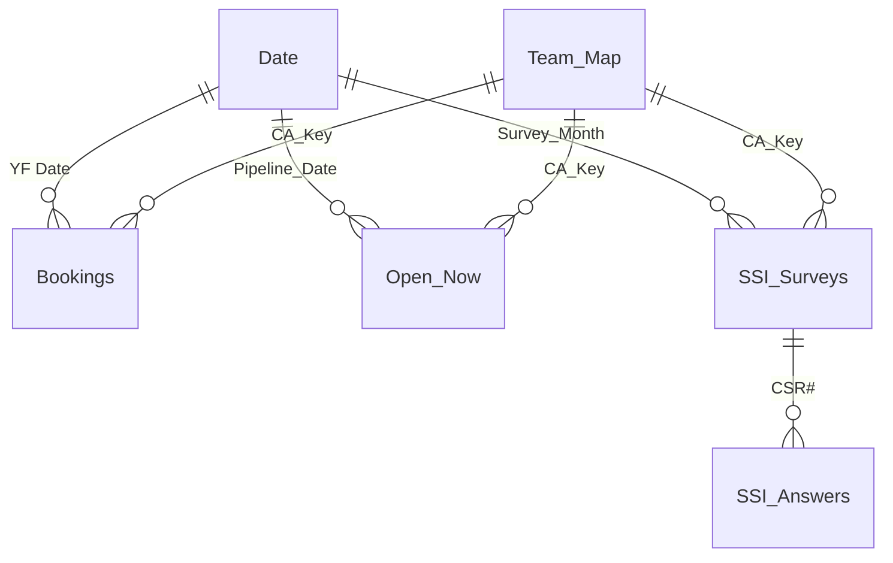

# Data model

The bot writes five workbooks to `data/database/`, and Power BI reads only these. Each one is written as a whole to a temp file of its own, read back, and only then swapped in, so Power BI never reads a half-written or damaged file. Before the first change of each day, a dated copy of each workbook is kept in `data/database/backup/` for 30 days.

## Workbooks and sheets

### master_bookings.xlsx: every booking ever seen

| Sheet | One row per | Columns (key ones in bold) |
|---|---|---|
| `Bookings` | booking (**Opty Id**) | **Opty Id**, **Vehicle_Type** (PV/EV), **Branch**, Division, Dealer Code, Dealer, **Employee Full Name**, Employee Login, Source, Opty Created Date, **YF Date** (booking date), Booking_Month, Booking_Month_Label, Financial_Year, Lead_to_Booking_Days, **Sales Stage**, **Stage_No**, Stage_Name, **Is_Sale_Closed**, Sale Closed, Full Name, Name_Repeated_Flag, Mobile No, Mobile_Masked, Repeat_Mobile_Count, **Repeat_Type**, Related_Opty_Ids, **Dup_Extra**, LOB, PPL (model), PL (variant), Color, Testdrive, Testdrive_Given, Test Drive Date, Month Name, **Missing_From_Latest**, **Pipeline_Status**, First_Seen_Date, Last_Seen_Date, Source_File |
| `Stage_History` | stage change | Opty Id, Vehicle_Type, Load_Date, Previous_Stage, Sales Stage, Stage_No |
| `Load_Log` | file loaded | Load_Date, Run_Time, Vehicle_Type, Source_File, Rows_Read, New, Updated, Unchanged, Missing_From_Latest, Rows_Skipped, Extra_Columns_Ignored, Status (OK / BACKFILL), Message |
| `DQ_Issues` | data problem | Severity (WARN/INFO), Check, Opty Id, Vehicle_Type, Branch, Employee Full Name, Detail |

Some columns need a word of explanation:

- **Stage numbers:**
  - 02 is an open enquiry (Green / Pink Form).
  - 03 is booked (Yellow Form).
  - 04 is vehicle allotted.
  - 06 is sale closed (delivered).
  - 07 is lost.
- **Repeat_Type** compares bookings that share a mobile number. Lost bookings are left out first, because "lost, then booked again" is normal.
  - *Possible duplicate – same variant* (WARN)
  - *Variant change – same model*
  - *Model change – different model*
  - *Rebooked after a lost booking*
  - *Single booking*
- **Dup_Extra** is 1 for every possible duplicate except the oldest one in its group. `SUM(Dup_Extra)` is how much the booking count may be overstated.
- **Pipeline_Status** is set from the open-pipeline file. The values are *Still open*, *Left pipeline (delivered or lost)*, *Sale closed* and *Lost*.

### open_pipeline.xlsx: what is open today

| Sheet | One row per | Columns |
|---|---|---|
| `Open_Now` | open record in today's snapshot | Snapshot_Date, Opty Id, Vehicle_Type, Branch, Division, Employee Full Name, Employee Login, Source, **Form**, **Form_Order** (1 Green, 2 Pink, 3 booked, 4 allotted), Sales Stage, Stage_No, Pipeline_Date, Pipeline_Month, Financial_Year, Opty Created Date, Created_Month, **Age_Days**, YF Date, YF_Month, **Wait_Days**, Days_In_Pipeline, **Age_Band**, Age_Band_Order, **Is_Stale_Enquiry**, **Is_Long_Wait**, Lead Classification, Customer Type, PPL, PL, Color, Testdrive, City, Full Name, Mobile No, Mobile_Masked, In_Bookings_DB, Bookings_Stage |
| `Open_Trend` | snapshot date × PV/EV × branch × form × age band | Open_Count, Stale_Or_Long_Wait |
| `Pipeline_Exits` | record that left the pipeline | Exit_Date, Opty Id, …, Last_Form, Last_Stage, Days_In_Pipeline, Outcome (Sale closed / Lost / Not known yet) |
| `Open_Issues` | hygiene item | Snapshot_Date, Severity, Check, Opty Id, Vehicle_Type, Branch, Employee Full Name, Detail |

### ssi.xlsx: customer-satisfaction surveys

| Sheet | One row per | Columns |
|---|---|---|
| `SSI_Surveys` | survey (**CSR#**) | CSR#, Vehicle_Type, **Survey_Month**, Assessment Date, Assessment Status, **Is_Done**, Branch, Division, PPL, PL, Chassis No, Registration No, Sale Date, Delivered to Customer Date, Days_Sale_To_Delivery, Days_Delivery_To_Call, Vehicle Usage, Customer, Mobile_Masked, CA_ID (CRM login), **CA**, **CA_Key**, **CA_Source**, **Total Score**, Box Category, Score_Band, Score_Band_Order, Lowest_Question, Lowest_Rating, No_Answers, Voice Of Customer (New), Load_Date |
| `SSI_Answers` | survey × question | CSR#, Vehicle_Type, Survey_Month, Q_No, Question, **Q_Type** (Yes / No, Rating 0-10, Time band, Information), Answer, **Points**, **Rating**, **Is_No**, **Has_Penalty** |
| `SSI_Issues` | survey to check | Issue (Seller not found / Shared ID – seller guessed / Survey not completed), CSR#, Vehicle_Type, Survey_Month, CA_ID, CA, Chassis No, Detail |

### team_map.xlsx: who reports to whom

| Sheet | One row per | Columns |
|---|---|---|
| `Team_Map` | CRM name × PV/EV (plus list-only new joiners) | **CA_Key** (`NAME\|PV`), Siebel_Name, Vehicle_Type, **CA**, **TL**, **SM**, **Team_Type**, Match, List_Row, Loaded_On |
| `Team_History` | CA's period in a team | CA_Key, CA, Vehicle_Type, TL, SM, Team_Type, Valid_From, Valid_To |
| `Map_Issues` | mapping note | Loaded_On, Issue, CA, Detail |

`Team_Type` is the CA's team, not the vehicle that was sold. When `Team_Type` differs from the booking's `Vehicle_Type`, the booking is a cross-sale (for example, a PV-team CA sold an EV). A CRM name that is not in the list gets *Not in team list*, so its numbers never disappear from the totals.

### run_log.xlsx: the Data Operations page

| Sheet | One row per | Columns |
|---|---|---|
| `Daily_Runs` | day | Run_Date, Weekday, **Status**, Status_Color, Headline, Bot_Started, **Ready_Time**, Ready_Hour, SLA_Target, SLA_Target_Hour, **SLA_Met**, Gmail_Reached, Files_Expected, Files_OK, Files_Missing, Files_Failed, Rows_Read, Recorded (Live / Rebuilt), Last_Update |
| `File_Loads` | day × file | Run_Date, Group, File, **File_Label**, File_Order, Required, Arrived, **Status** (OK / Not sent / Saved only / Not checked / Failed / Missing), Status_Order, **Cell_Text**, **Cell_Color**, Rows_Read, New, Updated, Unchanged, Note |
| `Data_Issues` | open data problem from any source | Source, **Severity**, Severity_Order, **Check**, Record_Id, Vehicle_Type, Branch, Person, Detail, **Fix_Where** |
| `Data_Freshness` | data source | Source, Source_Order, Workbook, Records, Latest_Data, Last_Loaded, **Days_Since_Load**, Checked_On |

`Cell_Text` and `Cell_Color` are ready-made for the arrival grid: a matrix of File_Label × Run_Date, with the background colour taken from the field value.

## Power BI model

The model is a star. Data tables point many-to-one, in a single direction, at a few lookup tables. Measures live in measure tables (`_Bookings`, `_Pipeline`, `_Team`, `_DataQuality`, `_PipelineOps`), never in data tables.

- **CA_Key** joins every fact table to the team list. `SSI_Surveys` already has it. For `Bookings` and `Open_Now`, add it in Power Query: *Add Column → Custom Column* `= [Employee Full Name] & "|" & [Vehicle_Type]`.
- **Date** drives the Month slicer. Pipeline cards and "latest month" cards wrap their filters in `REMOVEFILTERS('Date')`, so the slicer cannot change them.
- The four `run_log` tables have **no relationships**, so the Month slicer never touches Data Operations.
- Delete any relationship Power BI auto-detects that is not in the diagram. Such relationships create ambiguous filter paths.
